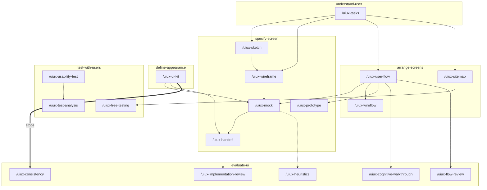

<p align="right">Idioma:&emsp;<a href="README.md" style="vertical-align:middle"></a> </p>

# UI/UX Design (`plugin-ui-ux-design`)

Diseña la experiencia y la interfaz de las pantallas de un producto digital: cómo se recorren, cómo se ven y cómo se construyen. No escribe el código de la interfaz.

Cada pieza vive en `skills/<skill>/references/`. El skill de cada comando está en [Skills](#skills). El resultado es Markdown y, cuando la pieza es visual, un SVG por pantalla. Los tokens van en `.tokens.json`. Las observaciones de prueba van en CSV.

Las instrucciones están en inglés. El archivo que el plugin guarda sigue el idioma del pedido.

## Para quién es

Quien diseña pantallas dentro de una conversación con el agente. Le pide los diagramas UML a `plugin-uml-diagrams`, la accesibilidad a `plugin-accessibility` y los textos a `plugin-ux-writing`. Este plugin no copia sus skills.

## Qué incluye

Portable, para cualquier agente que siga [Agent Skills](https://agentskills.io/specification):

- Siete skills. Cada uno lleva la carpeta de salida y las restricciones de fidelidad, para un agente que no carga rules.

Cursor y Claude Code:

- 25 comandos: `/uiux-help` (catálogo de una línea) y uno por pieza. En Cursor, `/uiux-help` o `/uiux-wireframe`. En Claude Code, `/plugin-ui-ux-design:uiux-help`.

Solo Cursor:

- Rule `output-folder`, que guarda todo en la carpeta de salida.
- Rule `ui-fidelity`, que impide un salto de fidelidad, una pantalla sin estados, o que este plugin haga el trabajo de otro.

## Instalar

En Cursor, instala el plugin desde este repositorio en Customize.

En Claude Code, este repositorio también es un marketplace:

```text
claude plugin marketplace add ADRenaline-Suite/plugin-ui-ux-design
claude plugin install plugin-ui-ux-design@plugin-ui-ux-design
```

Para probar una copia local sin instalarla, arranca Claude Code con `claude --plugin-dir <path to this repository>`.

En otro agente, instala el skill con el mecanismo de ese agente. Por ejemplo:

```text
gh skill install ADRenaline-Suite/plugin-ui-ux-design
```

## Configuración

No usa variables ni servicios.

Cada entrega se guarda en `ui-ux-design/` en la raíz del proyecto, con un `<NNN>` monótono que no se reutiliza. La misma entrega comparte ese número: el Markdown y su SVG, CSV o `.tokens.json`. La carpeta lleva `STATUS.md` (`proposed` | `accepted` | `deprecated` | `superseded`). Al elegir qué seguir, manda `accepted`. Junto a él, `ORIGIN.json` nombra este plugin (`suite`, `plugin`, `repository`, `convention` `adr-001`). No es un archivo `<NNN>`. La prosa del archivo sigue el idioma del pedido. El tipo en el nombre del archivo sigue siendo el id de la pieza en inglés. Las columnas de `STATUS.md` siguen `N`, `archivo`, `estado`, `sustituye`, `notas`.

Para usar otra carpeta, agrega `.cursor/adrenaline.json` al proyecto:

```json
{
  "outputDirs": {
    "plugin-ui-ux-design": "docs/ui"
  }
}
```

La ruta es relativa a la raíz del proyecto y no puede contener `..`. Claude Code y los demás agentes leen el mismo archivo.

## Cómo pedirlo

Si un nombre de comando no es familiar, lee [Para qué sirve cada comando](#para-qué-sirve-cada-comando) antes de las tablas de abajo.

En Cursor, `/uiux-sketch` o el nombre de otro comando. En Claude Code, el mismo nombre con el prefijo del plugin: `/plugin-ui-ux-design:uiux-sketch`. Pedirlo en lenguaje natural basta: el skill elige la referencia. Un pedido en español produce un archivo en español.

Antes de cerrar, el comando revisa la lista de terminado de ese skill y de esa pieza. Un archivo que falla una comprobación se corrige en el mismo turno, o no se marca `accepted`.

Un prerrequisito se cumple con un archivo `accepted` o con el dato escrito en el mismo mensaje. Si falta, el comando escribe la pieza con la plantilla nombrada y lo dice al final: qué se tomó automáticamente, el comando que lo cambia y el comando que regenera la pieza. El sketch y el wireframe se pueden saltar. Un handoff sin texto o sin notas se queda en `proposed`. Sin kit, sin valores y sin un preset nombrado, se escribe el preset `plain`. Los otros presets son `dense`, `material-3`, `hig` y `fluent-2`. Dos comprobaciones siguen sin escribir nada: una revisión de implementación sin captura o sin URL, y una revisión de consistencia sin un kit de interfaz del producto o sin una pantalla. La consistencia no usa `plain`. No se entrega HTML.

## Para qué sirve cada comando

No hace falta conocer los términos de diseño. Cada comando escribe una pieza del trabajo. El skill que se nombra con él es solo el grupo al que pertenece esa pieza. Puedes ignorar el nombre del skill y usar el comando.

Un skill es la carpeta de instrucciones de varios comandos relacionados. Lo encuentras cuando pides con una frase («dibuja el checkout») en lugar de escribir un comando. La frase bajo cada skill dice cuándo ese grupo es el adecuado.

### `/uiux-help`

Imprime la lista corta de skills, rules y comandos. No escribe un archivo. Úsalo cuando quieras ver qué puedes pedir.

### Entender a la persona — skill `understand-user`

Usa este grupo antes de que exista cualquier pantalla. Escribe qué intenta hacer la persona, por qué pasa y qué significa el éxito. No dibuja la interfaz.

#### `/uiux-tasks`

Escribe la meta de la persona, las tareas que la alcanzan y los pasos de cada tarea, en orden. Una tarea es algo que la persona termina, como pagar un pedido, no un botón. Úsalo cuando conoces la meta y necesitas esa lista antes de que alguien dibuje una pantalla.

#### `/uiux-journey-map`

Escribe el recorrido de una persona en una situación: qué hace, qué piensa, cómo se siente y dónde el producto podría ayudar. No propone pantallas. Úsalo cuando quieres la experiencia alrededor del producto, incluido lo que pasa fuera de la interfaz. Dices quién es la persona y qué situación quieres decir.

#### `/uiux-brief`

Escribe el brief de diseño: el problema, para quién es, los límites (plataforma, tiempo, qué queda fuera) y cómo sabrás que funcionó. Úsalo cuando el equipo debe ponerse de acuerdo en el problema antes de elegir una forma para la interfaz.

### Especificar una pantalla — skill `specify-screen`

Usa este grupo para describir una pantalla, desde una idea burda hasta las notas con las que alguien puede construir. Cada comando es un paso más. Los primeros se pueden saltar.

#### `/uiux-sketch`

Dibuja la idea de una pantalla como bloques con nombre, como búsqueda, lista y pago. Sin tamaños, sin colores y sin el texto final. Úsalo cuando quieres comprobar que las piezas de la pantalla son las correctas, antes de gastar tiempo en la disposición.

#### `/uiux-wireframe`

Dibuja la disposición: qué es grande, qué es pequeño y cómo cambia eso cuando la ventana es estrecha o ancha. Sigue sin colores de marca y sin la tipografía final. Úsalo cuando los bloques ya se conocen y la pregunta es dónde se sienta cada uno.

#### `/uiux-mock`

Dibuja la pantalla como debe verse: colores, tipo y componentes tomados del kit de interfaz. No describe el camino entre pantallas ni las medidas para construir. Úsalo cuando necesitas la apariencia terminada de una pantalla.

#### `/uiux-prototype`

Enlaza varias pantallas para que una persona pueda recorrer una tarea en el navegador. Sirve para caminar el camino. No fija tamaños ni reglas de accesibilidad. Úsalo cuando quieres probar la secuencia de pantallas antes de construir.

#### `/uiux-handoff`

Escribe lo que alguien necesita para construir la pantalla sin adivinar: tamaños, estados (vacío, carga, error y el resto), el texto, cómo se comporta en cada tamaño de ventana y las notas de accesibilidad. Úsalo cuando la pantalla está decidida y alguien está por construirla. El texto viene de `plugin-ux-writing` o de lo que pegues. Las notas de accesibilidad vienen de `plugin-accessibility`.

### Ordenar pantallas — skill `arrange-screens`

Usa este grupo cuando la pregunta es cómo se conectan las pantallas, no cómo se ve una.

#### `/uiux-user-flow`

Dibuja el camino de una tarea: qué pantalla sigue, dónde decide la persona y dónde puede volver. No dibuja la disposición dentro de cada pantalla. Úsalo cuando necesitas ponerte de acuerdo en el camino antes de que las pantallas se vean terminadas.

#### `/uiux-wireflow`

Dibuja ese mismo camino con una disposición simple en cada paso, todavía sin color de marca ni medidas para construir. Úsalo cuando el camino es difícil de juzgar sin ver qué hay en cada pantalla.

#### `/uiux-sitemap`

Lista qué pantallas existen y cómo se agrupan, como una tabla de contenido del producto. No muestra el camino de una tarea ni el aspecto de una pantalla. Úsalo cuando necesitas el inventario de pantallas y sus grupos.

### Definir la apariencia — skill `define-appearance`

Usa este grupo para cómo se ve la interfaz a través de las pantallas, no para el contenido de una.

#### `/uiux-moodboard`

Reúne la dirección visual — referencias, color, tipo y tono — mostrada en pantallas de ejemplo, antes de que esas elecciones se vuelvan reglas reutilizables. Úsalo cuando todavía eliges una dirección y tienes referencias de partida.

#### `/uiux-ui-kit`

Escribe las piezas compartidas y los valores que hay detrás: colores, tipo, espaciado, radio de esquina y sombra, más las reglas para volver a usarlos. Si no nombras un kit, escribe un punto de partida plano y nombra otros cuatro (`dense`, `material-3`, `hig`, `fluent-2`). Úsalo cuando varias pantallas deben verse como el mismo producto.

### Evaluar la interfaz — skill `evaluate-ui`

Usa este grupo para encontrar problemas sin invitar personas. Cada resultado dice dónde está el problema, qué tan grave es y cómo corregirlo. No cambia el producto construido.

#### `/uiux-heuristics`

Revisa una pantalla contra una lista conocida de reglas de usabilidad y escribe los problemas que puede ver. Úsalo cuando tienes una pantalla o un flujo y quieres una crítica estructurada antes de una prueba con personas.

#### `/uiux-cognitive-walkthrough`

Recorre una tarea paso a paso y pregunta si una persona que conoce la meta, y nunca ha visto esta interfaz, podría encontrar el siguiente paso mirando. Úsalo cuando la pregunta es si alguien puede resolver la tarea.

#### `/uiux-consistency`

Compara una pantalla con el kit de interfaz y lista dónde la pantalla se aleja de esos componentes y valores. Úsalo cuando ya existe un kit y quieres saber qué no lo sigue.

#### `/uiux-flow-review`

Revisa el camino de una tarea: pasos de más, callejones sin salida y formas de volver que faltan. No juzga colores ni código. Úsalo cuando el camino está dibujado y quieres los problemas de ese camino.

#### `/uiux-implementation-review`

Compara una pantalla construida (una captura o una URL) con el handoff: tamaños, tokens, estados, tamaños de ventana y texto. Úsalo cuando algo ya se construyó y necesitas la lista de diferencias. Sin captura o sin URL se detiene. Sin un handoff `accepted` el archivo se queda en borrador.

### Probar con personas — skill `test-with-users`

Usa este grupo para planear una sesión con personas, o para leer resultados que alguien ya recogió. El plugin no recluta personas y no corre la sesión.

#### `/uiux-usability-test`

Escribe el plan: las tareas que la gente va a intentar, quién participa, qué observar y cómo anotarlo. No corre la sesión y no calcula resultados. Úsalo antes de que ocurran las sesiones.

#### `/uiux-test-analysis`

Lee las notas de una prueba de usabilidad y escribe lo que salió: con qué frecuencia se logró cada tarea, cuánto tardó, los problemas por gravedad y una puntuación de satisfacción cuando se recogió una. Úsalo cuando ya tienes los datos. Sin datos, el archivo se queda en borrador.

#### `/uiux-card-sorting`

Planea un card sort, donde las personas agrupan temas como les hace sentido, para que el menú siga sus grupos. Cuando los resultados ya existen, también escribe los grupos que aparecieron. No juzga un sitemap que ya existe. Úsalo antes de que los grupos de un sitemap queden fijos.

#### `/uiux-tree-testing`

Planea, y cuando hay datos también analiza, si las personas pueden encontrar un destino en el sitemap solo con las etiquetas, sin el diseño visual. Úsalo cuando los grupos existen y quieres saber si los nombres llevan a la gente al lugar correcto.

#### `/uiux-heart`

Escribe metas y métricas para un producto que ya está lanzado: felicidad, engagement, adopción, retención y éxito de la tarea. Cada una recibe una meta, algo que se puede observar y una métrica. Úsalo para decidir qué medir después del lanzamiento. No instala la medición. Sin un producto lanzado, el archivo se queda en borrador.

### Registrar una decisión — skill `record-decision`

Usa este grupo cuando la razón de una elección debe quedar escrita junto a las pantallas.

#### `/uiux-decision`

Escribe por qué la interfaz quedó de una manera: el contexto, las opciones, qué se eligió y qué se sigue de eso. No diseña la pantalla. La elección viene de ti. El plugin no escoge al ganador. Úsalo cuando quien lea después deba saber por qué se eligió esta opción. Hasta que confirmes la decisión, el archivo se queda en borrador.

## Skills

Cada comando pertenece a un skill. El skill es la categoría: agrupa las piezas del mismo tramo del oficio. El nombre es la carpeta `skills/<skill>/`.

| Skill | Qué cubre | Comandos |
| --- | --- | --- |
| [understand-user](skills/understand-user/SKILL.es.md) | Tareas, mapa de recorrido y brief, antes de dibujar | `/uiux-tasks`, `/uiux-journey-map`, `/uiux-brief` |
| [specify-screen](skills/specify-screen/SKILL.es.md) | Sketch, wireframe, mock, prototipo y handoff | `/uiux-sketch`, `/uiux-wireframe`, `/uiux-mock`, `/uiux-prototype`, `/uiux-handoff` |
| [arrange-screens](skills/arrange-screens/SKILL.es.md) | Flujo de usuario, wireflow y sitemap | `/uiux-user-flow`, `/uiux-wireflow`, `/uiux-sitemap` |
| [define-appearance](skills/define-appearance/SKILL.es.md) | Moodboard y kit de interfaz. Cinco presets; `plain` es el de partida | `/uiux-moodboard`, `/uiux-ui-kit` |
| [evaluate-ui](skills/evaluate-ui/SKILL.es.md) | Heurísticas, recorrido cognitivo, consistencia, revisión de flujo y revisión de implementación | `/uiux-heuristics`, `/uiux-cognitive-walkthrough`, `/uiux-consistency`, `/uiux-flow-review`, `/uiux-implementation-review` |
| [test-with-users](skills/test-with-users/SKILL.es.md) | Prueba de usabilidad, su análisis, card sorting, tree testing y HEART | `/uiux-usability-test`, `/uiux-test-analysis`, `/uiux-card-sorting`, `/uiux-tree-testing`, `/uiux-heart` |
| [record-decision](skills/record-decision/SKILL.es.md) | Decisión de diseño, y si esa decisión gobierna | `/uiux-decision` |

## Orden y prerrequisitos

Una flecha sólida significa que el destino escribe esa pieza anterior con su plantilla cuando falta, y luego sigue. Una flecha punteada se puede saltar, o la entrega se queda en `proposed`. La flecha gruesa hacia consistencia sigue deteniendo: esa revisión no usa el preset `plain`, y no dibuja una pantalla para compararla. Una revisión de implementación también se detiene cuando no hay captura ni URL. Cada grupo es el skill de esos comandos. El mapa de recorrido, el brief, el moodboard, el card sorting, HEART y la decisión no están en el diagrama: no dependen de otro comando. Sus huecos usan una plantilla, o se quedan en `proposed` con el blanco nombrado en la respuesta.



| Skill | Comando | Si falta |
| --- | --- | --- |
| `understand-user` | `/uiux-tasks` | Plantilla `single-task`. `accepted` |
| `understand-user` | `/uiux-journey-map` | Plantillas `role-from-task` y `complete-the-task`. `proposed`. Sin nombre ni biografía |
| `understand-user` | `/uiux-brief` | `task-unsupported` y `finish-unaided` dejan `proposed`. La plataforma `web` puede dejar `accepted` |
| `specify-screen` | `/uiux-sketch` | Plantilla `single-task`, escrita en este turno. `accepted` |
| `specify-screen` | `/uiux-wireframe` | Plantilla `single-task`. `accepted` |
| `arrange-screens` | `/uiux-user-flow` | Plantillas `single-task` y `linear-three`. `accepted` |
| `arrange-screens` | `/uiux-wireflow` | Plantillas `single-task` y `linear-three`. `accepted` |
| `arrange-screens` | `/uiux-sitemap` | Plantillas `one-group` y `single-task`. `accepted` |
| `define-appearance` | `/uiux-moodboard` | Plantilla `neutral`. `proposed`. No se busca una galería |
| `define-appearance` | `/uiux-ui-kit` | Preset `plain`. `accepted`. Los otros presets se nombran |
| `specify-screen` | `/uiux-mock` | `single-task`, `linear-three` y el preset `plain`. `accepted` |
| `specify-screen` | `/uiux-prototype` | `single-task`, `linear-three` y `task-blocks` (un wireframe en este turno). `accepted` |
| `specify-screen` | `/uiux-handoff` | Escribe la cadena del mock si hace falta. El texto y las notas se quedan en blanco. `proposed` hasta que lleguen |
| `evaluate-ui` | `/uiux-heuristics` | Escribe un sketch si no hay pantalla. La revisión se queda en `proposed` |
| `evaluate-ui` | `/uiux-cognitive-walkthrough` | `single-task` y `linear-three`. `proposed` si se escribieron en este turno |
| `evaluate-ui` | `/uiux-consistency` | Se detiene. Sin kit del producto, o sin pantalla: no se escribe nada. `plain` no se usa |
| `evaluate-ui` | `/uiux-flow-review` | Plantilla `linear-three`. `proposed` si el flujo se escribió en este turno |
| `evaluate-ui` | `/uiux-implementation-review` | Se detiene sin captura o sin URL. Sin un handoff `accepted` se queda en `proposed` |
| `test-with-users` | `/uiux-usability-test` | `single-task` y `nielsen-5` (5 personas, cualitativo, no reclutadas). `accepted` |
| `test-with-users` | `/uiux-test-analysis` | Sin filas: los resultados se quedan en blanco. `proposed`. No se inventa nada |
| `test-with-users` | `/uiux-card-sorting` | Plantilla `open`. Una lista de tarjetas vacía se queda en `proposed` |
| `test-with-users` | `/uiux-tree-testing` | Escribe un sitemap con `one-group`. Un plan es `accepted` |
| `test-with-users` | `/uiux-heart` | Sin lanzar: `proposed`. Sin cifras de uso |
| `record-decision` | `/uiux-decision` | Sin tomar: `proposed`. No se elige una opción |

La respuesta termina con una línea por plantilla: el valor tomado automáticamente, el comando que lo cambia y el comando que regenera la pieza. Las mismas líneas están en el archivo bajo `Assumed` y en las `notas` de `STATUS.md`. Un archivo `accepted` gana al mensaje, y el mensaje gana a la plantilla.

## Catálogo

| Comando | Skill | Pieza | Documentación |
| --- | --- | --- | --- |
| `/uiux-tasks` | [understand-user](skills/understand-user/SKILL.es.md) | Tareas | [referencia](skills/understand-user/references/tasks.es.md) |
| `/uiux-journey-map` | [understand-user](skills/understand-user/SKILL.es.md) | Mapa de recorrido | [referencia](skills/understand-user/references/journey-map.es.md) |
| `/uiux-brief` | [understand-user](skills/understand-user/SKILL.es.md) | Brief | [referencia](skills/understand-user/references/brief.es.md) |
| `/uiux-sketch` | [specify-screen](skills/specify-screen/SKILL.es.md) | Sketch | [referencia](skills/specify-screen/references/sketch.es.md) |
| `/uiux-wireframe` | [specify-screen](skills/specify-screen/SKILL.es.md) | Wireframe | [referencia](skills/specify-screen/references/wireframe.es.md) |
| `/uiux-mock` | [specify-screen](skills/specify-screen/SKILL.es.md) | Mock | [referencia](skills/specify-screen/references/mock.es.md) |
| `/uiux-prototype` | [specify-screen](skills/specify-screen/SKILL.es.md) | Prototipo | [referencia](skills/specify-screen/references/prototype.es.md) |
| `/uiux-handoff` | [specify-screen](skills/specify-screen/SKILL.es.md) | Handoff | [referencia](skills/specify-screen/references/handoff.es.md) |
| `/uiux-user-flow` | [arrange-screens](skills/arrange-screens/SKILL.es.md) | Flujo de usuario | [referencia](skills/arrange-screens/references/user-flow.es.md) |
| `/uiux-wireflow` | [arrange-screens](skills/arrange-screens/SKILL.es.md) | Wireflow | [referencia](skills/arrange-screens/references/wireflow.es.md) |
| `/uiux-sitemap` | [arrange-screens](skills/arrange-screens/SKILL.es.md) | Sitemap | [referencia](skills/arrange-screens/references/sitemap.es.md) |
| `/uiux-moodboard` | [define-appearance](skills/define-appearance/SKILL.es.md) | Moodboard | [referencia](skills/define-appearance/references/moodboard.es.md) |
| `/uiux-ui-kit` | [define-appearance](skills/define-appearance/SKILL.es.md) | Kit de interfaz | [referencia](skills/define-appearance/references/ui-kit.es.md) |
| `/uiux-heuristics` | [evaluate-ui](skills/evaluate-ui/SKILL.es.md) | Heurísticas | [referencia](skills/evaluate-ui/references/heuristics.es.md) |
| `/uiux-cognitive-walkthrough` | [evaluate-ui](skills/evaluate-ui/SKILL.es.md) | Recorrido cognitivo | [referencia](skills/evaluate-ui/references/cognitive-walkthrough.es.md) |
| `/uiux-consistency` | [evaluate-ui](skills/evaluate-ui/SKILL.es.md) | Consistencia | [referencia](skills/evaluate-ui/references/consistency.es.md) |
| `/uiux-flow-review` | [evaluate-ui](skills/evaluate-ui/SKILL.es.md) | Revisión de flujo | [referencia](skills/evaluate-ui/references/flow-review.es.md) |
| `/uiux-implementation-review` | [evaluate-ui](skills/evaluate-ui/SKILL.es.md) | Revisión de implementación | [referencia](skills/evaluate-ui/references/implementation-review.es.md) |
| `/uiux-usability-test` | [test-with-users](skills/test-with-users/SKILL.es.md) | Prueba de usabilidad | [referencia](skills/test-with-users/references/usability-test.es.md) |
| `/uiux-test-analysis` | [test-with-users](skills/test-with-users/SKILL.es.md) | Análisis de la prueba | [referencia](skills/test-with-users/references/test-analysis.es.md) |
| `/uiux-card-sorting` | [test-with-users](skills/test-with-users/SKILL.es.md) | Card sorting | [referencia](skills/test-with-users/references/card-sorting.es.md) |
| `/uiux-tree-testing` | [test-with-users](skills/test-with-users/SKILL.es.md) | Tree testing | [referencia](skills/test-with-users/references/tree-testing.es.md) |
| `/uiux-heart` | [test-with-users](skills/test-with-users/SKILL.es.md) | HEART | [referencia](skills/test-with-users/references/heart.es.md) |
| `/uiux-decision` | [record-decision](skills/record-decision/SKILL.es.md) | Decisión de diseño | [referencia](skills/record-decision/references/decision.es.md) |

## Licencia

MIT. Ver [LICENSE](LICENSE).
