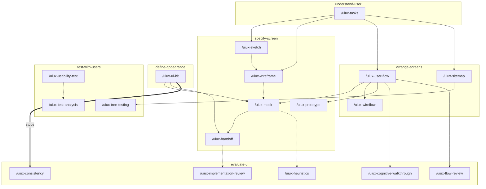

<p align="right">Language:&emsp; <a href="README.es.md" style="vertical-align:middle"></a></p>

# UI/UX Design (`plugin-ui-ux-design`)

Designs the experience and the interface of the screens of a digital product: how they are walked, how they look, and how they are built. It does not write the interface code.

Each piece lives in `skills/<skill>/references/`. The skill of each command is in [Skills](#skills). The result is Markdown and, when the piece is visual, one SVG per screen. Tokens go in `.tokens.json`. Test observations go in CSV.

The instructions are in English. The file the plugin saves follows the language of the request.

## Who it is for

Someone designing screens inside a conversation with the agent. They ask `plugin-uml-diagrams` for UML diagrams, `plugin-accessibility` for accessibility, and `plugin-ux-writing` for copy. This plugin does not copy their skills.

## What it includes

Portable, for any agent that follows [Agent Skills](https://agentskills.io/specification):

- Seven skills. Each one carries the output folder and the fidelity restrictions, for an agent that does not load rules.

Cursor and Claude Code:

- 25 commands: `/uiux-help` (one-line catalog) and one per piece. In Cursor, `/uiux-help` or `/uiux-wireframe`. In Claude Code, `/plugin-ui-ux-design:uiux-help`.

Cursor only:

- Rule `output-folder`, which keeps everything in the output folder.
- Rule `ui-fidelity`, which stops a jump in fidelity, a screen without states, or this plugin doing another plugin's job.

## Install

In Cursor, install the plugin from this repository in Customize.

In Claude Code, this repository is also a marketplace:

```text
claude plugin marketplace add ADRenaline-Suite/plugin-ui-ux-design
claude plugin install plugin-ui-ux-design@plugin-ui-ux-design
```

To try a local copy without installing it, start Claude Code with `claude --plugin-dir <path to this repository>`.

In another agent, install the skill with that agent's mechanism. For example:

```text
gh skill install ADRenaline-Suite/plugin-ui-ux-design
```

## Configuration

It uses no variables and no services.

Each delivery is saved in `ui-ux-design/` at the project root, with a monotonic `<NNN>` that is not reused. The same delivery shares that number: the Markdown and its SVG, CSV, or `.tokens.json`. The folder keeps `STATUS.md` (`proposed` | `accepted` | `deprecated` | `superseded`). When choosing what to follow, `accepted` wins. Beside it, `ORIGIN.json` names this plugin (`suite`, `plugin`, `repository`, `convention` `adr-001`). It is not an `<NNN>` file. The prose of the file follows the language of the request. The type in the file name stays the English piece id. The `STATUS.md` columns stay `N`, `archivo`, `estado`, `sustituye`, `notas`.

To use another folder, add `.cursor/adrenaline.json` to the project:

```json
{
  "outputDirs": {
    "plugin-ui-ux-design": "docs/ui"
  }
}
```

The path is relative to the project root and cannot contain `..`. Claude Code and other agents read the same file.

## How to ask

If a command name is unfamiliar, read [What each command is for](#what-each-command-is-for) before the tables below.

In Cursor, `/uiux-sketch` or the name of another command. In Claude Code, the same name with the plugin prefix: `/plugin-ui-ux-design:uiux-sketch`. Asking in plain language is enough: the skill chooses the reference. A request in Spanish produces a Spanish file.

Before it closes, the command checks the done list of that skill and of that piece. A file that fails a check is corrected in the same turn, or it is not marked `accepted`.

A prerequisite is met by an `accepted` file or by the fact written in the same message. If it is missing, the command writes the piece with the named template and says so at the end: what was assumed automatically, the command that changes it, and the command that regenerates the piece. Sketch and wireframe can still be skipped. A handoff without copy or without notes stays `proposed`. With no kit, no values, and no named preset, preset `plain` is written. The other presets are `dense`, `material-3`, `hig`, and `fluent-2`. Two checks still write nothing: an implementation review without a screenshot or a URL, and a consistency review without a product UI kit or without a screen. Consistency does not use `plain`. HTML is not delivered.

## What each command is for

You do not need to know design terms. Each command writes one piece of the work. The skill named with it is only the group that piece belongs to. You can ignore the skill name and use the command.

A skill is the folder of instructions for several related commands. You meet it when you ask in a sentence ("sketch the checkout") instead of typing a command. The sentence under each skill says when that group is the right one.

### `/uiux-help`

Prints the short list of skills, rules, and commands. It does not write a file. Use it when you want to see what you can ask for.

### Understand the user — skill `understand-user`

Use this group before any screen exists. It writes what the person is trying to do, what they go through, and what success means. It does not draw the interface.

#### `/uiux-tasks`

Writes the person's goal, the tasks that reach it, and the steps of each task, in order. A task is something the person finishes, such as paying for an order, not a button. Use it when you know the goal and you need that list before anyone draws a screen.

#### `/uiux-journey-map`

Writes one person's path through one situation: what they do, what they think, how they feel, and where the product could help. It does not propose screens. Use it when you want the experience around the product, including what happens outside the interface. You say who the person is and which situation you mean.

#### `/uiux-brief`

Writes the design brief: the problem, who it is for, the limits (platform, time, what is out of scope), and how you will know it worked. Use it when the team should agree on the problem before choosing a shape for the interface.

### Specify a screen — skill `specify-screen`

Use this group to describe one screen, from a rough idea to the notes someone can build from. Each command is a step further. The early ones can be skipped.

#### `/uiux-sketch`

Draws the idea of a screen as named blocks, such as search, list, and pay. No sizes, no colors, and no final wording. Use it when you want to check that the pieces of the screen are the right ones, before spending time on layout.

#### `/uiux-wireframe`

Draws the layout: what is large, what is small, and how that changes when the window is narrow or wide. It still has no brand colors and no final typeface. Use it when the blocks are known and the question is where each one sits.

#### `/uiux-mock`

Draws the screen as it should look: colors, type, and components taken from the UI kit. It does not describe the path between screens or the measurements for building. Use it when you need the finished appearance of one screen.

#### `/uiux-prototype`

Links several screens so a person can click through one task in the browser. It is for walking the path. It does not set sizes or accessibility rules. Use it when you want to try the sequence of screens before building.

#### `/uiux-handoff`

Writes what someone needs in order to build the screen without guessing: sizes, states (empty, loading, error, and the rest), the wording, how it behaves at each window size, and the accessibility notes. Use it when the screen is decided and someone is about to build it. The wording comes from `plugin-ux-writing` or from what you paste. The accessibility notes come from `plugin-accessibility`.

### Arrange screens — skill `arrange-screens`

Use this group when the question is how screens connect, not how one screen looks.

#### `/uiux-user-flow`

Draws the path of one task: which screen comes next, where the person decides, and where they can go back. It does not draw the layout inside each screen. Use it when you need to agree on the path before the screens look finished.

#### `/uiux-wireflow`

Draws that same path with a simple layout at each step, still without brand color or measurements for building. Use it when the path is hard to judge without seeing what is on each screen.

#### `/uiux-sitemap`

Lists which screens exist and how they are grouped, like a table of contents of the product. It does not show the path of one task or the look of a screen. Use it when you need the inventory of screens and their groups.

### Define the appearance — skill `define-appearance`

Use this group for how the interface looks across screens, not for the content of one screen.

#### `/uiux-moodboard`

Collects the visual direction — references, color, type, and tone — shown on sample screens, before those choices become reusable rules. Use it when you are still choosing a direction and you have references to start from.

#### `/uiux-ui-kit`

Writes the shared pieces and the values behind them: colors, type, spacing, corner radius, and shadow, plus the rules for using them again. If you do not name a kit, it writes a plain starting point and names four others (`dense`, `material-3`, `hig`, `fluent-2`). Use it when several screens should look like the same product.

### Evaluate the interface — skill `evaluate-ui`

Use this group to find problems without inviting people in. Each result says where the problem is, how serious it is, and how to fix it. It does not change the built product.

#### `/uiux-heuristics`

Reviews a screen against a known list of usability rules and writes the problems it can see. Use it when you have a screen or a flow and you want a structured critique before a test with people.

#### `/uiux-cognitive-walkthrough`

Walks a task one step at a time and asks whether a person who knows the goal, and has never seen this interface, could find the next step by looking. Use it when the question is whether someone can figure the task out.

#### `/uiux-consistency`

Compares a screen with the UI kit and lists where the screen drifts from those components and values. Use it when a kit already exists and you want to know what does not follow it.

#### `/uiux-flow-review`

Reviews the path of a task: extra steps, dead ends, and missing ways back. It does not judge colors or code. Use it when the path is drawn and you want the problems in that path.

#### `/uiux-implementation-review`

Compares a built screen (a screenshot or a URL) with the handoff: sizes, tokens, states, window sizes, and wording. Use it when something has been built and you need the list of differences. Without a screenshot or a URL it stops. Without an accepted handoff the file stays a draft.

### Test with users — skill `test-with-users`

Use this group to plan a session with people, or to read results someone already collected. The plugin does not recruit people and does not run the session.

#### `/uiux-usability-test`

Writes the plan: the tasks people will try, who takes part, what to watch, and how to write it down. It does not run the session and it does not calculate results. Use it before the sessions happen.

#### `/uiux-test-analysis`

Reads the notes from a usability test and writes what came out: how often each task succeeded, how long it took, the problems by severity, and a satisfaction score when one was collected. Use it when you already have the data. Without data, the file stays a draft.

#### `/uiux-card-sorting`

Plans a card sort, where people group topics the way that makes sense to them, so the menu can follow their groups. When the results already exist, it also writes the groups that appeared. It does not judge a sitemap that already exists. Use it before the groups of a sitemap are frozen.

#### `/uiux-tree-testing`

Plans, and when there is data also analyzes, whether people can find a destination in the sitemap from the labels alone, without the visual design. Use it when the groups exist and you want to know if the names lead people to the right place.

#### `/uiux-heart`

Writes goals and metrics for a product that is already launched: happiness, engagement, adoption, retention, and task success. Each one gets a goal, something you can observe, and a metric. Use it to decide what to measure after launch. It does not install the measurement. Without a launched product, the file stays a draft.

### Record a decision — skill `record-decision`

Use this group when the reason for a choice should stay written next to the screens.

#### `/uiux-decision`

Writes why the interface ended one way: the context, the options, what was chosen, and what follows from that. It does not design the screen. The choice comes from you. The plugin does not pick the winner. Use it when a later reader should know why this option was chosen. Until you confirm the decision, the file stays a draft.

## Skills

Each command belongs to a skill. The skill is the category: it groups the pieces of the same stretch of the craft. The name is the folder `skills/<skill>/`.

| Skill | What it covers | Commands |
| --- | --- | --- |
| [understand-user](skills/understand-user/SKILL.md) | Tasks, journey map, and brief, before drawing | `/uiux-tasks`, `/uiux-journey-map`, `/uiux-brief` |
| [specify-screen](skills/specify-screen/SKILL.md) | Sketch, wireframe, mock, prototype, and handoff | `/uiux-sketch`, `/uiux-wireframe`, `/uiux-mock`, `/uiux-prototype`, `/uiux-handoff` |
| [arrange-screens](skills/arrange-screens/SKILL.md) | User flow, wireflow, and sitemap | `/uiux-user-flow`, `/uiux-wireflow`, `/uiux-sitemap` |
| [define-appearance](skills/define-appearance/SKILL.md) | Moodboard and UI kit. Five presets; `plain` is the default | `/uiux-moodboard`, `/uiux-ui-kit` |
| [evaluate-ui](skills/evaluate-ui/SKILL.md) | Heuristics, cognitive walkthrough, consistency, flow review, and implementation review | `/uiux-heuristics`, `/uiux-cognitive-walkthrough`, `/uiux-consistency`, `/uiux-flow-review`, `/uiux-implementation-review` |
| [test-with-users](skills/test-with-users/SKILL.md) | Usability test, its analysis, card sorting, tree testing, and HEART | `/uiux-usability-test`, `/uiux-test-analysis`, `/uiux-card-sorting`, `/uiux-tree-testing`, `/uiux-heart` |
| [record-decision](skills/record-decision/SKILL.md) | Design decision, and whether that decision governs | `/uiux-decision` |

## Order and prerequisites

A solid arrow means the destination writes that earlier piece with its template when it is missing, then continues. A dotted arrow can be skipped, or the delivery stays `proposed`. The thick arrow into consistency still stops: that review does not use preset `plain`, and it does not draw a screen in order to compare it. An implementation review also stops when there is no screenshot or URL. Each group is the skill of those commands. Journey map, brief, moodboard, card sorting, HEART, and the decision are not in the diagram: they do not depend on another command. Their own gaps use a template, or stay `proposed` with the blank named in the reply.



| Skill | Command | If it is missing |
| --- | --- | --- |
| `understand-user` | `/uiux-tasks` | Template `single-task`. `accepted` |
| `understand-user` | `/uiux-journey-map` | Templates `role-from-task` and `complete-the-task`. `proposed`. No name or biography |
| `understand-user` | `/uiux-brief` | `task-unsupported` and `finish-unaided` leave `proposed`. Platform `web` can leave `accepted` |
| `specify-screen` | `/uiux-sketch` | Template `single-task`, written in this turn. `accepted` |
| `specify-screen` | `/uiux-wireframe` | Template `single-task`. `accepted` |
| `arrange-screens` | `/uiux-user-flow` | Templates `single-task` and `linear-three`. `accepted` |
| `arrange-screens` | `/uiux-wireflow` | Templates `single-task` and `linear-three`. `accepted` |
| `arrange-screens` | `/uiux-sitemap` | Templates `one-group` and `single-task`. `accepted` |
| `define-appearance` | `/uiux-moodboard` | Template `neutral`. `proposed`. No gallery is searched |
| `define-appearance` | `/uiux-ui-kit` | Preset `plain`. `accepted`. The other presets are named |
| `specify-screen` | `/uiux-mock` | `single-task`, `linear-three`, and preset `plain`. `accepted` |
| `specify-screen` | `/uiux-prototype` | `single-task`, `linear-three`, and `task-blocks` (a wireframe in this turn). `accepted` |
| `specify-screen` | `/uiux-handoff` | Writes the mock chain if needed. Copy and notes stay blank. `proposed` until they arrive |
| `evaluate-ui` | `/uiux-heuristics` | Writes a sketch if there is no screen. The review stays `proposed` |
| `evaluate-ui` | `/uiux-cognitive-walkthrough` | `single-task` and `linear-three`. `proposed` if they were written in this turn |
| `evaluate-ui` | `/uiux-consistency` | Stops. No product kit, or no screen: nothing is written. `plain` is not used |
| `evaluate-ui` | `/uiux-flow-review` | Template `linear-three`. `proposed` if the flow was written in this turn |
| `evaluate-ui` | `/uiux-implementation-review` | Stops without a screenshot or a URL. Without an `accepted` handoff it stays `proposed` |
| `test-with-users` | `/uiux-usability-test` | `single-task` and `nielsen-5` (5 people, qualitative, not recruited). `accepted` |
| `test-with-users` | `/uiux-test-analysis` | No rows: results stay blank. `proposed`. Nothing is invented |
| `test-with-users` | `/uiux-card-sorting` | Template `open`. An empty card list stays `proposed` |
| `test-with-users` | `/uiux-tree-testing` | Writes a sitemap with `one-group`. A plan is `accepted` |
| `test-with-users` | `/uiux-heart` | Not launched: `proposed`. No usage figures |
| `record-decision` | `/uiux-decision` | Not made: `proposed`. No option is chosen |

The reply ends with one line per template: the value taken automatically, the command that changes it, and the command that regenerates the piece. The same lines are in the file under `Assumed` and in `STATUS.md` `notas`. An `accepted` file wins over the message, and the message wins over the template.

## Catalog

| Command | Skill | Piece | Documentation |
| --- | --- | --- | --- |
| `/uiux-tasks` | [understand-user](skills/understand-user/SKILL.md) | Tasks | [reference](skills/understand-user/references/tasks.md) |
| `/uiux-journey-map` | [understand-user](skills/understand-user/SKILL.md) | Journey map | [reference](skills/understand-user/references/journey-map.md) |
| `/uiux-brief` | [understand-user](skills/understand-user/SKILL.md) | Brief | [reference](skills/understand-user/references/brief.md) |
| `/uiux-sketch` | [specify-screen](skills/specify-screen/SKILL.md) | Sketch | [reference](skills/specify-screen/references/sketch.md) |
| `/uiux-wireframe` | [specify-screen](skills/specify-screen/SKILL.md) | Wireframe | [reference](skills/specify-screen/references/wireframe.md) |
| `/uiux-mock` | [specify-screen](skills/specify-screen/SKILL.md) | Mock | [reference](skills/specify-screen/references/mock.md) |
| `/uiux-prototype` | [specify-screen](skills/specify-screen/SKILL.md) | Prototype | [reference](skills/specify-screen/references/prototype.md) |
| `/uiux-handoff` | [specify-screen](skills/specify-screen/SKILL.md) | Handoff | [reference](skills/specify-screen/references/handoff.md) |
| `/uiux-user-flow` | [arrange-screens](skills/arrange-screens/SKILL.md) | User flow | [reference](skills/arrange-screens/references/user-flow.md) |
| `/uiux-wireflow` | [arrange-screens](skills/arrange-screens/SKILL.md) | Wireflow | [reference](skills/arrange-screens/references/wireflow.md) |
| `/uiux-sitemap` | [arrange-screens](skills/arrange-screens/SKILL.md) | Sitemap | [reference](skills/arrange-screens/references/sitemap.md) |
| `/uiux-moodboard` | [define-appearance](skills/define-appearance/SKILL.md) | Moodboard | [reference](skills/define-appearance/references/moodboard.md) |
| `/uiux-ui-kit` | [define-appearance](skills/define-appearance/SKILL.md) | UI kit | [reference](skills/define-appearance/references/ui-kit.md) |
| `/uiux-heuristics` | [evaluate-ui](skills/evaluate-ui/SKILL.md) | Heuristics | [reference](skills/evaluate-ui/references/heuristics.md) |
| `/uiux-cognitive-walkthrough` | [evaluate-ui](skills/evaluate-ui/SKILL.md) | Cognitive walkthrough | [reference](skills/evaluate-ui/references/cognitive-walkthrough.md) |
| `/uiux-consistency` | [evaluate-ui](skills/evaluate-ui/SKILL.md) | Consistency | [reference](skills/evaluate-ui/references/consistency.md) |
| `/uiux-flow-review` | [evaluate-ui](skills/evaluate-ui/SKILL.md) | Flow review | [reference](skills/evaluate-ui/references/flow-review.md) |
| `/uiux-implementation-review` | [evaluate-ui](skills/evaluate-ui/SKILL.md) | Implementation review | [reference](skills/evaluate-ui/references/implementation-review.md) |
| `/uiux-usability-test` | [test-with-users](skills/test-with-users/SKILL.md) | Usability test | [reference](skills/test-with-users/references/usability-test.md) |
| `/uiux-test-analysis` | [test-with-users](skills/test-with-users/SKILL.md) | Test analysis | [reference](skills/test-with-users/references/test-analysis.md) |
| `/uiux-card-sorting` | [test-with-users](skills/test-with-users/SKILL.md) | Card sorting | [reference](skills/test-with-users/references/card-sorting.md) |
| `/uiux-tree-testing` | [test-with-users](skills/test-with-users/SKILL.md) | Tree testing | [reference](skills/test-with-users/references/tree-testing.md) |
| `/uiux-heart` | [test-with-users](skills/test-with-users/SKILL.md) | HEART | [reference](skills/test-with-users/references/heart.md) |
| `/uiux-decision` | [record-decision](skills/record-decision/SKILL.md) | Design decision | [reference](skills/record-decision/references/decision.md) |

## License

MIT. See [LICENSE](LICENSE).
