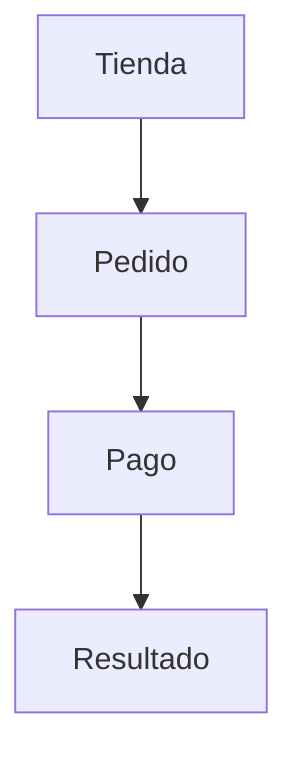

<p align="right">Idioma:&emsp;<a href="sitemap.md" style="vertical-align:middle"></a> </p>

[🏠 UI/UX Design](../../../README.es.md) / [Ordenar pantallas](../SKILL.es.md)

# Sitemap

Fuente: el agrupamiento de pantallas de este plugin. No es un diagrama de paquetes UML. Comprobar si las personas encuentran un ítem en esa jerarquía es tree testing (`test-with-users`), no este mapa.

## Qué fija

Qué pantallas existen y cómo se agrupan.

## Qué deja abierto

El camino de una tarea (flujo de usuario) y la apariencia de cada pantalla.

## Cómo hacerlo

1. Un grupo es un lugar del producto (Cuenta, Pedido, Pago). Una hoja es una pantalla.
2. Cada pantalla nombra la tarea o el caso de uso que cubre. Si una pantalla no cubre ninguna, aplica la plantilla `single-task` para esa pantalla.
3. Mermaid `flowchart` de arriba abajo, o una lista anidada si el mapa es corto. Sin notación UML.
4. No renombres grupos que quien pide ya dio. Cuando no hay grupos, la plantilla `one-group` nombra el grupo «Main» (en el idioma del pedido) y las pantallas son las que se nombraron, o formulario, espera y resultado cuando no se nombra ninguna. Proponer otros nombres es una decisión (`record-decision`) o un hallazgo de card sorting.

## Plantilla

````markdown
# Sitemap — <product>

- Plataforma:
- Fuente: el mapa de pantallas de este plugin. No es UML.



## Pantallas

| Grupo | Pantalla | Tarea o caso de uso |
| --- | --- | --- |
````

## Ejemplo

Tienda → Pedido → Pago → Resultado. Pago cubre la tarea «pagar con tarjeta». Resultado cubre la misma tarea, en el estado de éxito.

## Prerrequisitos

- **Pantallas y grupos.** La lista, en este turno. Si falta, plantilla `one-group`: un grupo «Main» (en el idioma del pedido) y las pantallas nombradas en el pedido, o formulario, espera y resultado cuando no se nombra ninguna. Estado: `accepted`. Cámbialo con `/uiux-sitemap`. Regenera con `/uiux-sitemap`.
- **Tarea.** Cada pantalla nombra la tarea que cubre. Un análisis de tareas `accepted`, o la tarea en este turno. Si no existe ninguno de los dos, plantilla `single-task` en cada pantalla, escrita como un análisis de tareas en este turno. Estado: `accepted`. Cámbialo con `/uiux-tasks`. Regenera este sitemap con `/uiux-sitemap`.

## Indicaciones

En un mensaje:

```text
/uiux-sitemap de la tienda.
Grupos: Tienda → Pedido → Pago → Resultado.
Pago y Resultado cubren la tarea pagar con tarjeta.
```

En orden, omitiendo los que ya se cumplieron:

```text
/uiux-tasks
La meta es pagar un pedido con tarjeta. Tareas: revisar el monto, ingresar la tarjeta, confirmar.
```

## Terminado

- Los grupos y las pantallas son los que listó quien pide, o la plantilla `one-group` cuando no se listó ninguno. `Assumed` dice cuál. Los nombres que dio quien pide no se renombraron. Cada pantalla nombra la tarea o el caso de uso que cubre.
- El dibujo es un `flowchart` de Mermaid o una lista anidada. Sin notación UML.
- No están el camino de una tarea ni la apariencia de cada pantalla.
