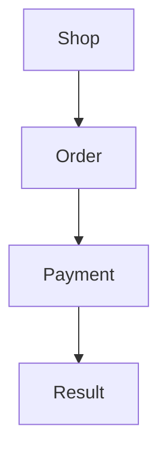

<p align="right">Language:&emsp; <a href="sitemap.es.md" style="vertical-align:middle"></a></p>

[🏠 UI/UX Design](../../../README.md) / [Arrange screens](../SKILL.md)

# Sitemap

Source: this plugin's grouping of screens. It is not a UML package diagram. Checking whether people find an item in that hierarchy is tree testing (`test-with-users`), not this map.

## What it fixes

Which screens exist and how they are grouped.

## What it leaves open

The path of one task (user flow) and the appearance of each screen.

## How to do it

1. A group is a place in the product (Account, Order, Payment). A leaf is a screen.
2. Each screen names the task or the use case it covers. If a screen covers none, apply template `single-task` for that screen.
3. Mermaid `flowchart` top to bottom, or a nested list if the map is short. No UML notation.
4. Do not rename groups the user already gave. When no groups are given, template `one-group` names the group "Main" (in the language of the request) and the screens are the ones named, or form, wait, and result when none are named. Proposing other names is a decision (`record-decision`) or a card-sorting finding.

## Template

````markdown
# Sitemap — <product>

- Platform:
- Source: this plugin's screen map. It is not UML.



## Screens

| Group | Screen | Task or use case |
| --- | --- | --- |
````

## Example

Shop → Order → Payment → Result. Payment covers the task "pay with a card". Result covers the same task, in the success state.

## Prerequisites

- **Screens and groups.** The list, in this turn. If it is missing, template `one-group`: one group "Main" (in the language of the request) and the screens named in the request, or form, wait, and result when none are named. State: `accepted`. Change it with `/uiux-sitemap`. Regenerate with `/uiux-sitemap`.
- **Task.** Each screen names the task it covers. An `accepted` task analysis, or the task in this turn. If neither exists, template `single-task` on each screen, written as a task analysis in this turn. State: `accepted`. Change it with `/uiux-tasks`. Regenerate this sitemap with `/uiux-sitemap`.

## Prompts

In one message:

```text
/uiux-sitemap of the shop.
Groups: Shop → Order → Payment → Result.
Payment and Result cover the task pay with a card.
```

In order, omitting the ones already met:

```text
/uiux-tasks
The goal is to pay an order with a card. Tasks: review the amount, enter the card, confirm.
```

## Done

- Groups and screens are the ones the user listed, or template `one-group` when none were listed. Assumed says which. Names the user gave were not renamed. Each screen names the task or use case it covers.
- The drawing is a Mermaid `flowchart` or a nested list. No UML notation.
- The path of one task and the appearance of each screen are absent.
