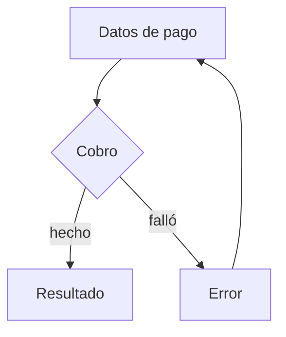

<p align="right">Idioma:&emsp;<a href="user-flow.md" style="vertical-align:middle"></a> </p>

[🏠 UI/UX Design](../../../README.es.md) / [Ordenar pantallas](../SKILL.es.md)

# Flujo de usuario

Fuente: Nielsen Norman Group, Task Analysis, para la tarea que completa el camino. El dibujo es un flujo de pantallas en Mermaid, no un diagrama UML.

## Qué fija

El camino entre pantallas para completar una tarea, incluidas las decisiones y las vueltas.

## Qué deja abierto

La disposición de cada pantalla. Eso es el wireframe o el wireflow.

## Cómo hacerlo

1. Un nodo es una pantalla. Una decisión es un rombo con salidas con nombre. El inicio es la primera pantalla de la tarea.
2. Todo camino termina en éxito, en un error del que la persona puede salir, o en una salida que pidió quien pide. Si un nodo no tiene salida, es un callejón sin salida: márcalo y deja la entrega `proposed` hasta que se resuelva.
3. El error de una tarea que conserva datos vuelve a la pantalla donde están esos datos.
4. Usa `flowchart`. No uses la sintaxis UML de actividad, de estado ni de secuencia.
5. El Markdown nombra la tarea y lista las pantallas.

## Plantilla

````markdown
# Flujo de usuario — <task>

- Tarea o caso de uso:
- Fuente: Nielsen Norman Group, Task Analysis. Este flujo no es UML.



## Pantallas

| Pantalla | Tarea que cubre |
| --- | --- |
````

## Ejemplo

Pagar con tarjeta. Desde «Datos de pago» el camino va a «Resultado» si el cobro sale bien, o a «Error» si falla. «Error» vuelve a «Datos de pago».

## Prerrequisitos

- **Tarea.** Un análisis de tareas `accepted`, o la tarea en este turno. Si no existe ninguno de los dos, escríbela con la plantilla `single-task`. Estado: `accepted`. Cámbialo con `/uiux-tasks`. Regenera este flujo con `/uiux-user-flow`.
- **Pantallas.** La lista de pantallas del camino, en este turno. Si falta, plantilla `linear-three`: las pantallas nombradas en el pedido, en ese orden; una pantalla se convierte en esa pantalla y luego un resultado, y el error vuelve a ella con los datos conservados; si no se nombra ninguna, quedan formulario, espera, resultado. Un pago o una acción irreversible inserta una confirmación antes del resultado. Estado: `accepted`. Cámbialo con `/uiux-user-flow`. Regenera con `/uiux-user-flow`.

## Indicaciones

En un mensaje:

```text
/uiux-user-flow para pagar con tarjeta.
La tarea es pagar con tarjeta.
Pantallas: carrito, pago, resultado. Si el cobro falla, vuelve al pago con los datos todavía rellenos.
```

En orden, omitiendo los que ya se cumplieron:

```text
/uiux-tasks
La meta es pagar un pedido con tarjeta. Tareas: revisar el monto, ingresar la tarjeta, confirmar.
```

## Terminado

- El dibujo es un `flowchart` de Mermaid. Los nodos son pantallas. Las decisiones tienen salidas con nombre. No es sintaxis UML de actividad, de estado ni de secuencia.
- Todo camino termina en éxito, en un error del que la persona puede salir, o en una salida que pidió quien pide. Un nodo sin salida queda marcado y la entrega es `proposed`.
- Un error que conserva datos vuelve a la pantalla donde están esos datos. Cada pantalla nombra la tarea que cubre. No se dibuja la disposición.
