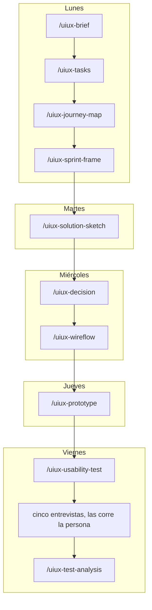

<p align="right">Idioma:&emsp;<a href="SKILL.md" style="vertical-align:middle"></a> </p>

[🏠 UI/UX Design](../../README.es.md)

# Facilitar un design sprint

Corre un design sprint como una secuencia de piezas que ya tienen dueño, más las dos que escribe este skill. El lunes cierra el marco. El martes registra cada idea que compite. El resto de la semana se pide al comando que ya escribe esa pieza.

Fuente: Jake Knapp, John Zeratsky y Braden Kowitz, *Sprint* (Simon & Schuster, 2016). El lunes cierra una meta de largo plazo, las preguntas del sprint y un objetivo. El boceto de solución del martes es una idea que se explica sola, en tres tiempos, y no es la ganadora. El mapa es el mapa de recorrido de `understand-user`. Los bloques de una pantalla son `/uiux-sketch`. La decisión es `/uiux-decision`. El storyboard es `/uiux-wireflow`. El prototipo es `/uiux-prototype`. La prueba del viernes es `/uiux-usability-test` y `/uiux-test-analysis`. El resultado de negocio pertenece a `plugin-product`. Este skill no entrevista a expertos, no cita a nadie y no corre las sesiones del viernes.

## Antes de escribir

1. Si el mensaje pide los pasos, el orden o los prompts, y no pide escribir una pieza, responde con [La semana](#la-semana) en el idioma del pedido y no escribas archivos. Conserva cada nombre de comando. Traduce las frases del prompt.
2. Si este turno viene de un comando, la pieza ya está fijada. Si no, elige una pieza de la tabla. Si piden las dos, haz las dos entregas, cada una con su `<NNN>`.
3. Lee solo la referencia de la pieza que pidieron. No leas referencias de otro skill. Excepción: la plantilla `single-task` lee `understand-user` `references/tasks.md` y escribe esa pieza.
4. No elijas la idea ganadora. No escribas en este turno el brief, el mapa de recorrido, el sketch de pantalla, la decisión, el wireflow, el prototipo, la prueba de usabilidad ni el análisis. El boceto de solución puede escribir el análisis de tareas en este turno cuando su referencia dice plantilla `single-task` y no existe un análisis de tareas `accepted`. Nombra el comando siguiente. No lo ejecutes. El resultado de negocio se queda en `plugin-product`. Si existe un resultado `accepted`, la meta de largo plazo cita su archivo.
5. No escribas HTML ni código de interfaz. Estas dos piezas son Markdown. No añaden un SVG.

| Pedido | Pieza | Referencia |
| --- | --- | --- |
| Meta de largo plazo, preguntas del sprint y el momento objetivo | marco del sprint | [references/sprint-frame.es.md](references/sprint-frame.es.md) |
| Una idea que compite, antes de elegir ganador | boceto de solución | [references/solution-sketch.es.md](references/solution-sketch.es.md) |

## Idioma

Las instrucciones se quedan en inglés. Escribe el artefacto en el idioma del pedido. Si el pedido nombra un idioma, usa ese. Si no, usa el idioma en el que está escrito el pedido. Conserva los nombres que la persona ya usó. Traduce los encabezados de la plantilla de la referencia y mantén los mismos campos. El tipo en el nombre del archivo sigue el id de la pieza en inglés (`sprint-frame` o `solution-sketch`). Las columnas de `STATUS.md` siguen `N`, `archivo`, `estado`, `sustituye`, `notas`. La respuesta usa ese mismo idioma, incluido el bloque Assumed cuando se aplicó una plantilla y las tres partes cuando un prerrequisito todavía detiene la entrega. Los prompts de la referencia están en inglés: muéstralos en el idioma del pedido y conserva los nombres de los comandos.

## Cuando falta un prerrequisito

Un prerrequisito se cumple con un archivo `accepted` de esa pieza, o con el dato escrito en este turno. La referencia de la pieza nombra cada prerrequisito, la plantilla que lo llena, el estado que esa plantilla deja, el comando que lo cambia y el comando que regenera esta pieza.

Usa las fuentes en este orden: un archivo `accepted`, luego el dato de este turno, luego la plantilla. No apliques una plantilla cuando existe una fuente más alta.

Cuando la referencia da una plantilla, escribe los archivos. En el mismo turno, escribe también las piezas anteriores que esa referencia dice que hay que escribir, cada una con su `<NNN>`, y solo esas. No escribas una pieza que este pedido no necesita.

En el Markdown, añade un encabezado `Assumed`, traducido al idioma del pedido. Una línea por plantilla: el hueco, el id de la plantilla y el valor usado. Las `notas` de esa fila en `STATUS.md` listan los ids (`assumed: two-year-outcome, one-question`).

Después de la carpeta, los archivos, el `N` y el estado, cierra con este bloque, en el idioma del pedido. Una línea por plantilla. Omite el bloque cuando no se asumió nada.

```text
Se tomó automáticamente (no había un archivo accepted y este mensaje no lo trajo):
- <hueco>: plantilla <id> (<valor usado>). Cámbialo con <comando>. Regenera con <comando>.
```

Una plantilla que la referencia marca `proposed` deja la entrega en `proposed`. Cada línea dice que el valor es un punto de partida, tomado automáticamente, y que no es un dato de la persona, de una investigación ni de otro plugin.

Si la referencia no da plantilla y no detiene, escribe el artefacto como dice y, al cerrar, nombra el comando que llena el hueco. Di que el blanco se dejó a propósito y que no se inventó nada para llenarlo.

Este skill no tiene una parada que no escriba nada. No inventes el nombre ni la biografía de una persona, una idea que compite ni al ganador.

## Entrega

La carpeta es `adrenaline/ui-ux-design/` en la raíz del proyecto. Si `.cursor/adrenaline.json` tiene `outputDirs["plugin-ui-ux-design"]` en una ruta relativa, sin `..` y no absoluta, usa esa ruta. Si falta el archivo, la clave o una ruta válida, usa `adrenaline/ui-ux-design/` y, en el último caso, dilo. Si `adrenaline/ui-ux-design/` aún no existe y `ui-ux-design/` en la raíz ya tiene el `ORIGIN.json` o el `STATUS.md` de este plugin, sigue escribiendo ahí y dilo. Crea la carpeta si no existe. No escribas fuera de ella.

Un asunto es una subcarpeta, `<topic>` en kebab-case (`login`, `reservar-mesa`). Los archivos de ese asunto van ahí, incluidas las piezas escritas en el mismo turno. Un asunto distinto abre otra subcarpeta. `<NNN>` es el siguiente número libre en toda la carpeta de salida, y no se reutiliza. `STATUS.md` y `ORIGIN.json` se quedan en la carpeta de salida. La celda `archivo` es `<topic>/<archivo>`.

El archivo es `<NNN>-sprint-frame-<topic>.md` o `<NNN>-solution-sketch-<topic>.md`. `<NNN>` es el siguiente entero libre, de tres dígitos, y no se reutiliza.

Mantén `<carpeta>/STATUS.md` con las columnas `N`, `archivo`, `estado`, `sustituye` y `notas`. El estado de la fila es el de la pieza.

Mantén `<carpeta>/ORIGIN.json` junto a `STATUS.md`. No es un archivo `<NNN>` y no tiene fila en `STATUS.md`. Escríbelo cuando se crea la carpeta. En una entrega posterior, escríbelo de nuevo solo si falta o si un campo difiere. Los campos son `suite` `ADRenaline-Suite`, `plugin` `plugin-ui-ux-design`, `repository` `https://github.com/ADRenaline-Suite/plugin-ui-ux-design` y `convention` `adr-001`. El marcador nombra la carpeta. No dice que cada archivo de dentro quedó sin cambios.

Si el asunto ya tiene un archivo del mismo tipo:

- La persona pide enmendar ese mismo archivo: edita el mismo archivo, conserva el `<NNN>` y conserva `accepted` si ya lo estaba.
- La persona lo reemplaza: el siguiente `<NNN>`, la fila anterior pasa a `superseded` (`sustituye` apunta al `N` nuevo) y la fila nueva toma el estado que corresponde.
- Un segundo boceto de solución para otra idea: el siguiente `<NNN>`. No sustituyas la otra idea.
- Asunto nuevo: el siguiente `<NNN>`.

`proposed` cuando se aplicó una plantilla, o cuando la idea sigue pendiente. `accepted` cuando los datos que la referencia exige vinieron de la persona o de un archivo `accepted`. Al cerrar, di la carpeta, el archivo, el `N`, el estado y el comando siguiente. No ejecutes ese comando.

## La semana

Un mensaje es un comando. Espera el archivo antes del mensaje siguiente. El asunto del ejemplo es reservar una mesa. Sustitúyelo por el que nombró la persona.

Estos son los comandos que se piden, en este orden. El viernes, las cinco entrevistas las corre la persona: no hay un comando para eso.



| Día | Qué pedir |
| --- | --- |
| Lunes | `/uiux-brief`, `/uiux-tasks`, `/uiux-journey-map`, `/uiux-sprint-frame` |
| Martes | `/uiux-solution-sketch`, una vez por idea |
| Miércoles | `/uiux-decision`, luego `/uiux-wireflow` |
| Jueves | `/uiux-prototype` |
| Viernes | `/uiux-usability-test`. Después de las entrevistas, `/uiux-test-analysis` |

1. `/uiux-brief` — el problema, para quién es, la plataforma y el criterio de éxito. El prompt está en [brief.es.md](../understand-user/references/brief.es.md).
2. `/uiux-tasks` — la meta y las tareas. El prompt está en [tasks.es.md](../understand-user/references/tasks.es.md).
3. `/uiux-journey-map` — el mapa. El prompt está en [journey-map.es.md](../understand-user/references/journey-map.es.md).
4. `/uiux-sprint-frame` — la meta de largo plazo, las preguntas del sprint y el objetivo. El prompt está en [sprint-frame.es.md](references/sprint-frame.es.md).
5. `/uiux-solution-sketch` — una idea por mensaje. El prompt está en [solution-sketch.es.md](references/solution-sketch.es.md). Una segunda idea es otro mensaje y otro `<NNN>`.
6. `/uiux-decision` — la persona elige. Este skill no elige. El prompt está en [decision.es.md](../record-decision/references/decision.es.md).
7. `/uiux-wireflow` — el storyboard de la idea elegida. El prompt está en [wireflow.es.md](../arrange-screens/references/wireflow.es.md).
8. `/uiux-prototype` — el prototipo de ese camino. El prompt está en [prototype.es.md](../specify-screen/references/prototype.es.md).
9. `/uiux-usability-test` — el plan para cinco personas. El prompt está en [usability-test.es.md](../test-with-users/references/usability-test.es.md). La persona corre las entrevistas. Este plugin no cita y no corre la sesión.
10. `/uiux-test-analysis` — cuando ya existen las notas. El prompt está en [test-analysis.es.md](../test-with-users/references/test-analysis.es.md). Sin filas, el archivo se queda en `proposed`.

Ejemplo, un asunto, en orden:

```text
/uiux-brief de reservar mesa.
Problema: quien quiere una mesa para esta noche no sabe si quedó apartada.
Para quién: quien reserva desde el teléfono.
Plataforma: web.
Éxito: en la tarea reservar una mesa, reconoce si quedó confirmada sin preguntarle a nadie. Umbral: lo logra en el primer intento.
```

```text
/uiux-tasks de reservar mesa.
La meta es reservar una mesa para esta noche. Tareas: ver la hora propuesta, confirmar, reconocer que la mesa quedó reservada.
```

```text
/uiux-journey-map de reservar mesa.
Quién: quien reserva desde el teléfono.
Situación: quiere una mesa para dos, esta noche, y hoy no sabe si quedó apartada.
```

```text
/uiux-sprint-frame de reservar mesa.
Meta de largo plazo: en dos años, quien reserva desde el teléfono sabe que la mesa quedó apartada.
Pregunta del sprint: ¿puede ver que la mesa quedó apartada en el primer intento?
Objetivo: quien reserva desde el teléfono, en el momento en que busca la confirmación.
```

```text
/uiux-solution-sketch de reservar mesa.
Idea: una pantalla que propone hoy a las 8 para dos personas, con confirmar y cambiar.
Tarea: reservar una mesa.
Para quién: quien reserva desde el teléfono.
```

```text
/uiux-solution-sketch de reservar mesa.
Idea: un formulario con fecha, hora, número de personas y un botón reservar.
Tarea: reservar una mesa.
Para quién: quien reserva desde el teléfono.
```

```text
/uiux-decision de reservar mesa.
Decisión: una sola pantalla con la hora propuesta y confirmar.
Opciones descartadas: el formulario de fecha, hora y personas por separado.
```

```text
/uiux-wireflow de reservar mesa.
Tarea: reservar una mesa.
Camino: ver la propuesta de hoy a las 8 para dos, confirmar, ver que la mesa quedó reservada. Si algo falla, se queda en la misma pantalla.
```

```text
/uiux-prototype de reservar mesa.
Tarea: reservar una mesa.
Camino: ver la propuesta, confirmar, ver la confirmación.
```

```text
/uiux-usability-test de reservar mesa.
La tarea es reservar una mesa para esta noche.
Cinco personas que ya han reservado por teléfono.
```

```text
/uiux-test-analysis de reservar mesa.
Filas, una por persona:
participant,task,success,time_s,errors,assistance,notes
1,reservar una mesa,yes,40,0,no,encontró confirmar
2,reservar una mesa,no,90,1,yes,no vio que la mesa quedó apartada
```

`success` es `yes`, `no` o `partial`. Las filas del ejemplo son una forma. No son observaciones de una sesión. Un análisis real usa las notas que trae la persona.

## Terminado

Antes de cerrar, evalúa esta lista y la lista `## Terminado` de la referencia de esta situación. Un comando fija la situación: usa la referencia que nombra ese comando. Cada ítem es cierto, o corriges la entrega en este turno. No dejes un archivo que falle un ítem. No lo marques `accepted` mientras un ítem falla. Una plantilla que nombra la referencia se aplica y se anota en Assumed; la entrega usa el estado que nombra esa referencia. Un pedido de los pasos no escribe archivos y no usa los ítems de entrega de abajo: la respuesta es la secuencia de la semana.

- La situación de este turno es la única que se escribe, salvo que el pedido pidiera dos. Cada entrega tiene su `<NNN>`.
- Los archivos están solo en la carpeta de salida, bajo `<topic>/`, con el nombre que dice Entrega. `<NNN>` no se reutiliza. `STATUS.md` coincide con los archivos y con el estado que esta situación permite. Un hueco que la referencia deja en `proposed` se queda en `proposed`.
- `ORIGIN.json` está en la carpeta de salida. Sus cuatro campos coinciden con este plugin. No tiene fila en `STATUS.md`.
- El idioma del artefacto coincide con el pedido. Las columnas de `STATUS.md` siguen `N`, `archivo`, `estado`, `sustituye`, `notas`.
- Cada campo que exige la plantilla está lleno. No queda un placeholder (`#…`, `<task>`, `TBD`, lorem ipsum). Un campo que la referencia manda dejar en blanco hasta que llegue el dato está en blanco a propósito, y el estado es el que nombra la referencia.
- No se añadió nada que este skill prohíbe. La referencia nombra lo que se queda fuera. El comando siguiente se nombró y no se ejecutó.
- La respuesta nombra la carpeta, los archivos, el `N` y el estado. Si se aplicó una plantilla, la respuesta cierra con el bloque Assumed, una línea por plantilla, con el comando que lo cambia y el comando que regenera esta pieza. Un blanco dejado a propósito nombra el comando que lo llena.

## Ejemplo

Entrada: «/uiux-sprint-frame de reservar mesa. Meta de largo plazo: en dos años, quien reserva desde el teléfono sabe que la mesa quedó apartada. Pregunta del sprint: ¿puede ver que la mesa quedó apartada en el primer intento? Objetivo: quien reserva desde el teléfono, en el momento en que busca la confirmación.»

Salida `accepted`: `001-sprint-frame-reservar-mesa.md`, cuando ese número está libre. El comando siguiente que nombra la respuesta es `/uiux-solution-sketch`. El boceto de solución no se escribe en este turno.
