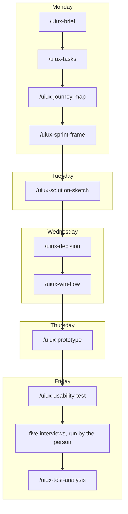

<p align="right">Language:&emsp; <a href="SKILL.es.md" style="vertical-align:middle"></a></p>

[🏠 UI/UX Design](../../README.md)

# Facilitate a design sprint

Run one design sprint as a sequence of pieces that already have an owner, plus the two pieces this skill writes. Monday closes the frame. Tuesday records each competing idea. The rest of the week is asked of the command that already writes that piece.

Source: Jake Knapp, John Zeratsky, and Braden Kowitz, *Sprint* (Simon & Schuster, 2016). Monday closes a long-term goal, the sprint questions, and a target. Tuesday's solution sketch is one self-explanatory idea in three beats, and it is not the winner. The map is the journey map of `understand-user`. The screen blocks are `/uiux-sketch`. The decision is `/uiux-decision`. The storyboard is `/uiux-wireflow`. The prototype is `/uiux-prototype`. The Friday test is `/uiux-usability-test` and `/uiux-test-analysis`. The business outcome belongs to `plugin-product`. This skill does not interview experts, recruit anyone, or run the Friday sessions.

## Before writing

1. If the message asks for the steps, the order, or the prompts, and does not ask to write a piece, reply with [The week](#the-week) in the language of the request and write no files. Keep every command name. Translate the prompt sentences.
2. If this turn comes from a command, the piece is already fixed. Otherwise pick one piece from the table. If they ask for both pieces, make both deliveries, each with its own `<NNN>`.
3. Read only the reference for the piece they asked for. Do not read references from another skill. Exception: template `single-task` reads `understand-user` `references/tasks.md` and writes that piece.
4. Do not pick the winning idea. Do not write the brief, the journey map, the screen sketch, the decision, the wireflow, the prototype, the usability test, or the test analysis in this turn. The solution sketch may write the task analysis in this turn when its reference says template `single-task` and no accepted task analysis exists. Name the next command. Do not run it. The business outcome stays with `plugin-product`. If an accepted outcome exists, the long-term goal cites its file.
5. Do not write HTML or interface code. These two pieces are Markdown. They do not add an SVG.

| Request | Piece | Reference |
| --- | --- | --- |
| Long-term goal, sprint questions, and the target moment | sprint frame | [references/sprint-frame.md](references/sprint-frame.md) |
| One competing idea, before a winner is picked | solution sketch | [references/solution-sketch.md](references/solution-sketch.md) |

## Language

The instructions stay in English. Write the artifact in the language of the request. If the request names a language, use that one. Otherwise use the language the request is written in. Keep names the person already used. Translate the headings of the reference template and keep the same fields. The type in the file name stays the English piece id (`sprint-frame` or `solution-sketch`). `STATUS.md` columns stay `N`, `archivo`, `estado`, `sustituye`, `notas`. The reply uses that same language, including the Assumed block when a template was applied and the three parts when a prerequisite still stops the delivery. The prompts in the reference are the English wording: show them in the language of the request and keep the command names.

## When a prerequisite is missing

A prerequisite is met by an `accepted` file of that piece, or by the fact written in this turn. The piece reference names each prerequisite, the template that fills it, the state that template leaves, the command that replaces it, and the command that regenerates this piece.

Use sources in this order: an `accepted` file, then the fact written in this turn, then the template. Do not apply a template when a higher source exists.

When the reference gives a template, write the files. In the same turn, also write the earlier pieces that reference says to write, each with its own `<NNN>`, and only those. Do not write a piece this request does not need.

In the Markdown, add a heading `Assumed`, translated to the language of the request. One line per template: the gap, the template id, and the value used. `STATUS.md` `notas` for that row lists the template ids (`assumed: two-year-outcome, one-question`).

After the folder, the files, the `N`, and the state, close with this block, in the language of the request. One line per template. Omit the block when nothing was assumed.

```text
Assumed automatically (there was no accepted file and this message did not bring it):
- <gap>: template <id> (<value used>). Change it with <command>. Regenerate with <command>.
```

A template the reference marks `proposed` leaves the delivery `proposed`. Each line says the value is a starting point, taken automatically, and is not a fact from the user, from research, or from another plugin.

If the reference gives no template and does not stop, write the artifact as it says and, when you close, name the command that fills the gap. Say that the blank was left on purpose and that nothing was invented for it.

This skill has no stop that writes nothing. Do not invent a persona's name or biography, a competing idea, or the winner.

## Delivery

The folder is `adrenaline/ui-ux-design/` at the project root. If `.cursor/adrenaline.json` has `outputDirs["plugin-ui-ux-design"]` set to a relative path, without `..` and not absolute, use that path. If the file, the key, or a valid path is missing, use `adrenaline/ui-ux-design/` and, in the last case, say so. If `adrenaline/ui-ux-design/` does not exist yet and `ui-ux-design/` at the project root already has this plugin's `ORIGIN.json` or `STATUS.md`, keep writing there and say so. Create the folder if it does not exist. Do not write outside it.

One subject is one subfolder, `<topic>` in kebab-case (`login`, `reservar-mesa`). Files of that subject go there, including the pieces written in the same turn. A different subject gets a new subfolder. `<NNN>` is the next free number in the whole output folder, and it is not reused. `STATUS.md` and `ORIGIN.json` stay in the output folder. The `archivo` cell is `<topic>/<file>`.

The file is `<NNN>-sprint-frame-<topic>.md` or `<NNN>-solution-sketch-<topic>.md`. `<NNN>` is the next free integer, three digits, and it is not reused.

Keep `<folder>/STATUS.md` with columns `N`, `archivo`, `estado`, `sustituye`, and `notas`. The row's state is the piece's state.

Keep `<folder>/ORIGIN.json` beside `STATUS.md`. It is not an `<NNN>` file and it has no row in `STATUS.md`. Write it when the folder is created. On a later delivery, write it again only when it is missing or a field differs. The fields are `suite` `ADRenaline-Suite`, `plugin` `plugin-ui-ux-design`, `repository` `https://github.com/ADRenaline-Suite/plugin-ui-ux-design`, and `convention` `adr-001`. The marker names the folder. It does not say that each file inside is unchanged.

If the topic already has a file of the same type:

- The user asks to amend that same file: edit the same file, keep the `<NNN>`, and keep `accepted` if it already was.
- The user replaces it: next `<NNN>`, the previous row becomes `superseded` (`sustituye` points at the new `N`), and the new row takes the state that fits.
- A second solution sketch for another idea: next `<NNN>`. Do not supersede the other idea.
- New topic: next `<NNN>`.

`proposed` when a template was applied, or when the idea is still pending. `accepted` when the facts the reference requires came from the user or from an `accepted` file. When you close, say the folder, the file, the `N`, the state, and the next command. Do not run that command.

## The week

One message is one command. Wait for the file before the next message. The example subject is reserving a table. Replace that subject with the one the person named.

These are the commands to ask for, in this order. On Friday the person runs the five interviews. There is no command for that.



| Day | What to ask for |
| --- | --- |
| Monday | `/uiux-brief`, `/uiux-tasks`, `/uiux-journey-map`, `/uiux-sprint-frame` |
| Tuesday | `/uiux-solution-sketch`, once per idea |
| Wednesday | `/uiux-decision`, then `/uiux-wireflow` |
| Thursday | `/uiux-prototype` |
| Friday | `/uiux-usability-test`. After the interviews, `/uiux-test-analysis` |

1. `/uiux-brief` — the problem, who it is for, the platform, and the success criterion. Prompt in [brief.md](../understand-user/references/brief.md).
2. `/uiux-tasks` — the goal and the tasks. Prompt in [tasks.md](../understand-user/references/tasks.md).
3. `/uiux-journey-map` — the map. Prompt in [journey-map.md](../understand-user/references/journey-map.md).
4. `/uiux-sprint-frame` — the long-term goal, the sprint questions, and the target. Prompt in [sprint-frame.md](references/sprint-frame.md).
5. `/uiux-solution-sketch` — one idea per message. Prompt in [solution-sketch.md](references/solution-sketch.md). A second idea is another message and another `<NNN>`.
6. `/uiux-decision` — the person chooses. This skill does not. Prompt in [decision.md](../record-decision/references/decision.md).
7. `/uiux-wireflow` — the storyboard of the idea that was chosen. Prompt in [wireflow.md](../arrange-screens/references/wireflow.md).
8. `/uiux-prototype` — the prototype of that path. Prompt in [prototype.md](../specify-screen/references/prototype.md).
9. `/uiux-usability-test` — the plan for five people. Prompt in [usability-test.md](../test-with-users/references/usability-test.md). The person runs the interviews. This plugin does not recruit and does not run the session.
10. `/uiux-test-analysis` — after the notes exist. Prompt in [test-analysis.md](../test-with-users/references/test-analysis.md). Without rows, the file stays `proposed`.

Example, one subject, in order:

```text
/uiux-brief for reserving a table.
Problem: the person who wants a table tonight does not know whether it is held.
Who it is for: the person who books from a phone.
Platform: web.
Success criterion: on the task reserve a table, they recognize whether it is confirmed without asking anyone. Threshold: they do it on the first attempt.
```

```text
/uiux-tasks for reserving a table.
The goal is to reserve a table for tonight. Tasks: see the proposed time, confirm, recognize that the table is reserved.
```

```text
/uiux-journey-map for reserving a table.
Who: the person who books from a phone.
Situation: they want a table for two, tonight, and today they do not know whether it is held.
```

```text
/uiux-sprint-frame for reserving a table.
Long-term goal: in two years, someone booking from a phone knows the table is held.
Sprint question: can they tell the table is held on the first try?
Target: the person booking from a phone, at the moment they look for the confirmation.
```

```text
/uiux-solution-sketch for reserving a table.
Idea: one screen that proposes tonight at 8 for two people, with confirm and change.
Task: reserve a table.
For whom: the person who books from a phone.
```

```text
/uiux-solution-sketch for reserving a table.
Idea: a form with date, time, number of people, and a reserve button.
Task: reserve a table.
For whom: the person who books from a phone.
```

```text
/uiux-decision for reserving a table.
Decision made: one screen with the proposed time and confirm.
Options discarded: the form with date, time, and party size on separate fields.
```

```text
/uiux-wireflow for reserving a table.
Task: reserve a table.
Path: see the proposal of tonight at 8 for two, confirm, see that the table is reserved. If something fails, they stay on the same screen.
```

```text
/uiux-prototype for reserving a table.
Task: reserve a table.
Path: see the proposal, confirm, see the confirmation.
```

```text
/uiux-usability-test for reserving a table.
The task is reserve a table for tonight.
Five people who have already booked by phone take part.
```

```text
/uiux-test-analysis for reserving a table.
Rows, one per person:
participant,task,success,time_s,errors,assistance,notes
1,reserve a table,yes,40,0,no,found confirm
2,reserve a table,no,90,1,yes,did not see that the table was held
```

`success` is `yes`, `no`, or `partial`. The rows in the example are a shape. They are not observations from a session. A real analysis uses the notes the person brings back.

## Done

Before you close, evaluate this list and the `## Done` list in the reference for this situation. A command fixes the situation: use the reference that command names. Every item is true, or you fix the delivery in this turn. Do not leave a file that fails an item. Do not mark it `accepted` while an item fails. A template the reference names is applied and recorded under Assumed; the delivery uses the state that reference names. A request for the steps writes no files and does not use the delivery items below: the reply is the week sequence.

- The situation of this turn is the only one written, unless the request asked for two. Each delivery has its own `<NNN>`.
- Files are only in the output folder, under `<topic>/`, named as Delivery says. `<NNN>` is not reused. `STATUS.md` matches the files and the state this situation allows. A gap the reference leaves as `proposed` stays `proposed`.
- `ORIGIN.json` is in the output folder. Its four fields match this plugin. It has no row in `STATUS.md`.
- The artifact language matches the request. `STATUS.md` columns stay `N`, `archivo`, `estado`, `sustituye`, `notas`.
- Every field the template requires is filled. No placeholder remains (`#…`, `<task>`, `TBD`, lorem ipsum). A field the reference tells you to leave blank until data arrives is blank on purpose, and the state is the one the reference names.
- Nothing this skill forbids was added. The reference names what stays out. The next command was named and was not run.
- The reply names the folder, the files, the `N`, and the state. If a template was applied, the reply ends with the Assumed block, one line per template, naming the command that changes it and the command that regenerates this piece. A blank left on purpose names the command that fills it.

## Example

Input: "/uiux-sprint-frame for reserving a table. Long-term goal: in two years, someone booking from a phone knows the table is held. Sprint question: can they tell the table is held on the first try? Target: the person booking from a phone, at the moment they look for the confirmation."

`accepted` output: `001-sprint-frame-reserve-a-table.md`, when that number is free. The next command named in the reply is `/uiux-solution-sketch`. The solution sketch is not written in this turn.
